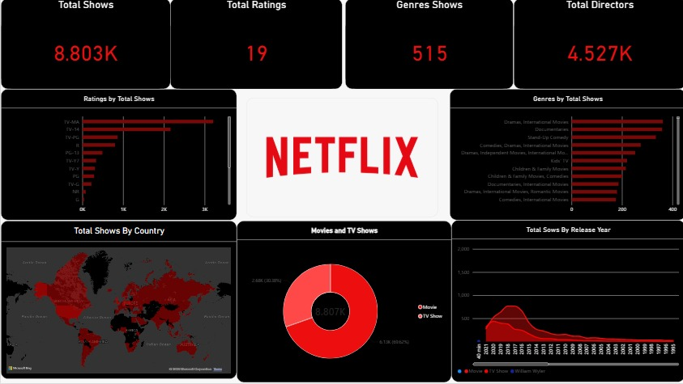

# Netflix Data Analysis Dashboard | Power BI

## Project Overview

This project explores Netflix's content library using an interactive Power BI dashboard. It examines the distribution of movies and TV shows, content ratings, popular genres, directors, countries, and release-year trends.

The goal is to turn raw data into meaningful visual insights and understand the composition of Netflix's content catalogue.

## Tools Used

- Microsoft Power BI Desktop
- Data visualization
- Netflix titles dataset

## Key Dashboard Features

- **KPI Cards:** Total shows, ratings, genres, and directors
- **Ratings Analysis:** Distribution of titles by content rating
- **Genre Analysis:** Comparison of genres by number of shows
- **Country Analysis:** Geographical distribution of Netflix titles
- **Movies vs. TV Shows:** Comparison of content types
- **Release-Year Trends:** Analysis of titles across release years

## Dashboard Preview

## Key Objectives

- Understand the distribution of movies and TV shows.
- Identify common genres and content ratings.
- Explore country-wise content distribution.
- Examine trends in Netflix titles across release years.
- Present findings through an interactive dashboard.

## Project File

The Power BI report is available in this repository as `Netflix_Analytics.pbix`.

Download the file and open it using Power BI Desktop to explore the report.

## Author

Dhivyasri

**Project:** Netflix Data Analysis using Power BI
